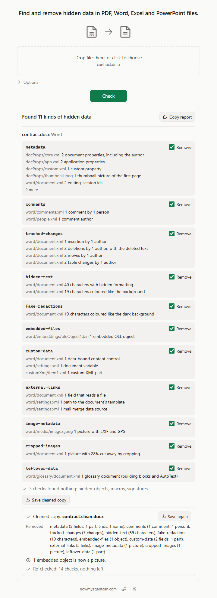

# doc-sanitize

Find and remove hidden data in PDF, Word, Excel and PowerPoint files before you send them: a command line tool with JSON output, a local web page, and an MCP server for AI agents. Everything runs on your computer.



## Install

Windows (PowerShell, no admin; installs to `%LOCALAPPDATA%\Programs\doc-sanitize` and adds it to your user PATH):

```powershell
irm https://github.com/nowmyagentcan/doc-sanitize/releases/latest/download/install.ps1 | iex
```

macOS and Linux (installs to `~/.local/bin`):

```sh
curl -fsSL https://github.com/nowmyagentcan/doc-sanitize/releases/latest/download/install.sh | sh
```

Both scripts check the archive's SHA-256 against `SHA256SUMS` before installing anything. Or download an archive yourself; each holds one `doc-sanitize` binary that needs no runtime:

| System | Download |
|---|---|
| Windows x64 | [doc-sanitize-v0.1.0-windows-x64.zip](https://github.com/nowmyagentcan/doc-sanitize/releases/download/v0.1.0/doc-sanitize-v0.1.0-windows-x64.zip) |
| macOS Apple silicon | [doc-sanitize-v0.1.0-macos-arm64.tar.gz](https://github.com/nowmyagentcan/doc-sanitize/releases/download/v0.1.0/doc-sanitize-v0.1.0-macos-arm64.tar.gz) |
| macOS Intel | [doc-sanitize-v0.1.0-macos-x64.tar.gz](https://github.com/nowmyagentcan/doc-sanitize/releases/download/v0.1.0/doc-sanitize-v0.1.0-macos-x64.tar.gz) |
| Linux x64 | [doc-sanitize-v0.1.0-linux-x64.tar.gz](https://github.com/nowmyagentcan/doc-sanitize/releases/download/v0.1.0/doc-sanitize-v0.1.0-linux-x64.tar.gz) |
| Linux arm64 | [doc-sanitize-v0.1.0-linux-arm64.tar.gz](https://github.com/nowmyagentcan/doc-sanitize/releases/download/v0.1.0/doc-sanitize-v0.1.0-linux-arm64.tar.gz) |

With Rust: `cargo install --git https://github.com/nowmyagentcan/doc-sanitize --tag v0.1.0 --locked`. To remove it, delete the binary.

## Use

```sh
doc-sanitize contract.docx                 # what is hidden in it
doc-sanitize redacted.pdf                  # is this redaction real?
doc-sanitize clean contract.docx           # write contract.clean.docx without it
doc-sanitize clean deck.pptx --keep speaker-notes -o deck-to-send.pptx
doc-sanitize clean exports/ -r --out-dir outbox/
doc-sanitize filing.pdf --show-values      # also print the hidden text itself
doc-sanitize                               # interactive: drop files, /clean, /help, /quit
```

```text
$ doc-sanitize filing.pdf
filing.pdf  found 4 kinds of hidden data
  ✗ comments         page 2: 1 annotation
  ✗ hidden-text      page 6: 17 characters the same colour as the background; page 8: 17 characters of invisible text; page 10: 18 characters outside the visible page; page 11: 18 characters hidden by a clipping path; page 12: 18 characters smaller than 1 point
  ✗ fake-redactions  page 1: 17 characters under a black box; page 2: 17 characters under a black box; page 3: 17 characters under a black box; page 4: 17 characters under a white box; page 5: 17 characters under a picture; page 7: 17 characters the same colour as the dark background under them; page 9: 17 characters under a black box; page 13: 18 characters under 1 redaction mark that was never applied
  ✗ hidden-layers    page 14: 1 layer that is switched off, with content on page 14
  ✓ 9 checks found nothing: metadata, embedded-files, macros, external-links, image-metadata, old-revisions, leftover-data, signatures, form-data
  Remove it: doc-sanitize clean filing.pdf

$ doc-sanitize clean filing.pdf
filing.pdf → filing.clean.pdf
  removed  comments (1 annotation), hidden-text (88 characters), fake-redactions (137 characters), hidden-layers (1 layer)
  changed  Pages 1, 2, 3, 4, 5, 6, 7, 8, 9, 10, 11, 12, 13 and 14 are now pictures; their text can't be selected or searched.
           1 redaction mark was applied: its area is now filled in black.
           1 annotation is now part of its page's picture.
  ✓ re-checked: 13 checks, nothing left
```

`clean` never changes the original. It writes a copy, checks that copy again, and keeps it only when nothing is left outside what you chose to keep. Removing things has visible effects, and each one is reported: tracked changes are accepted, a PDF page with hidden text becomes a picture, and Excel formulas that read a removed sheet become their saved values. A check that can't look at everything says `incomplete`; "nothing found" always lists the checks that ran, and never means a file is free of risk.

`doc-sanitize ui` opens the same checks as a page in your browser: drop files, untick what to keep, save the cleaned copy. Double-clicking `doc-sanitize.exe` on Windows does the same. Files stay in memory on 127.0.0.1 and are never written to disk.

### Use with AI agents

`--json` on a check or `clean` prints one JSON object; errors are `{"error": {"code", "message", "hint"}}`. Found text stays out of the output unless you pass `--show-values`.

```sh
doc-sanitize filing.pdf --json                   # is the redaction real? what is hidden?
doc-sanitize clean contract.docx --json          # copy without comments, changes, metadata
doc-sanitize clean deck.pptx --keep speaker-notes --json
```

The MCP server `doc-sanitize mcp` runs on stdio with two tools: `check_document` (read-only) and `clean_document`.

| Agent | Setup |
|---|---|
| Claude Code | `claude mcp add doc-sanitize -- doc-sanitize mcp` |
| Codex | `codex mcp add doc-sanitize -- doc-sanitize mcp` |
| Cursor (`~/.cursor/mcp.json`), Claude Desktop | `{"mcpServers":{"doc-sanitize":{"command":"doc-sanitize","args":["mcp"]}}}` |
| VS Code (`.vscode/mcp.json`) | `{"servers":{"doc-sanitize":{"type":"stdio","command":"doc-sanitize","args":["mcp"]}}}` |

## Supported inputs and limits

It reads `.pdf`, `.docx`, `.xlsx` and `.pptx` files and their macro and template versions (`.docm`, `.dotx`, `.dotm`, `.xlsm`, `.xltx`, `.xltm`, `.pptm`, `.potx`, `.potm`, `.ppsx`, `.ppsm`), up to 256 MiB each. Files are identified by their content, not their name. Encrypted PDFs open with `--password`.

| Check | What it finds |
|---|---|
| `metadata` | properties, author names, thumbnails, editing ids |
| `comments` | comments and annotations, and their authors |
| `tracked-changes` | insertions and deletions (with the deleted text), shared-workbook logs |
| `hidden-text` | hidden, white, tiny, clipped or off-page text |
| `fake-redactions` | text still under black boxes, images or unapplied redaction marks |
| `hidden-layers` | PDF layers that are switched off |
| `hidden-sheets`, `hidden-rows-columns` | hidden and very hidden sheets, hidden rows and columns that hold values |
| `hidden-slides`, `speaker-notes`, `hidden-objects` | slides hidden from the show, notes, hidden shapes and shapes off the slide |
| `embedded-files`, `custom-data` | attachments, OLE objects, chart workbooks; custom XML, document variables, tags, add-in data |
| `macros`, `external-links` | VBA, ActiveX, Excel 4.0 sheets, DDE fields, PDF scripts and actions; paths to local or network files, templates, data connections |
| `image-metadata`, `cropped-images` | EXIF, GPS, XMP and comments in pictures; picture areas hidden by cropping |
| `pivot-caches`, `old-revisions` | pivot table source data and data models; earlier saved versions inside a PDF |
| `leftover-data`, `signatures`, `form-data` | unused objects, orphan parts, bytes outside the file; digital signatures; XFA forms and values of hidden form fields |

What it doesn't check:

- Legacy `.doc`, `.xls` and `.ppt`, `.xlsb`, Strict Open XML, ODF, RTF and password-protected Office files: they are refused with a message, never skipped.
- Files inside embedded files: an embedded workbook is reported and removed, not opened.
- Covered or same-colour text in PowerPoint, and floating shapes over text in Word.
- Cropped or covered pictures in PDFs, and glyph-width leaks around real redactions.
- Bookmarks, protection password hashes, hidden defined names, EMF/WMF descriptions, JPEG 2000 metadata, Office ink and embedded fonts.

Tracked changes are always accepted, never rejected. Signatures can't be kept, because any change breaks them. Encrypted PDFs lose their password in the copy.

It makes no network requests: no update check, no telemetry. `ui` listens on 127.0.0.1 only, and `mcp` speaks only on stdin and stdout.

## How it works

Office files are read as raw ZIP entries first, so overlapping or two-faced packages are refused, then every XML part goes through a limited parser, and a clean edits the parts and rewrites the package. PDF pages are rendered and each glyph is tested against what actually shows, so text under a box or in the page's colour is caught by its pixels, and a page with hidden text is replaced by a picture of itself.

It uses [lopdf](https://github.com/J-F-Liu/lopdf) to read and rewrite PDFs, [hayro](https://github.com/LaurenzV/hayro) to render them, [zip](https://github.com/zip-rs/zip2) and [quick-xml](https://github.com/tafia/quick-xml) for Office files, and [image](https://github.com/image-rs/image) to crop pictures. Icons are from [Phosphor](https://phosphoricons.com) (MIT).

## First run on an unsigned build

Windows: if "Windows protected your PC" appears, choose More info, then Run anyway.
The install script doesn't trigger it; a zip extracted in Explorer may.

macOS: if it says the developer can't be verified, open System Settings, Privacy & Security, and choose Open Anyway.
The install script doesn't trigger it, because curl downloads carry no quarantine flag.

## Licence

Apache-2.0, see [LICENSE](LICENSE). Each release archive includes `THIRD-PARTY-LICENSES.txt` for the bundled dependencies.

---

[nowmyagentcan.com](https://nowmyagentcan.com) · [x.com/chayp05](https://x.com/chayp05)
